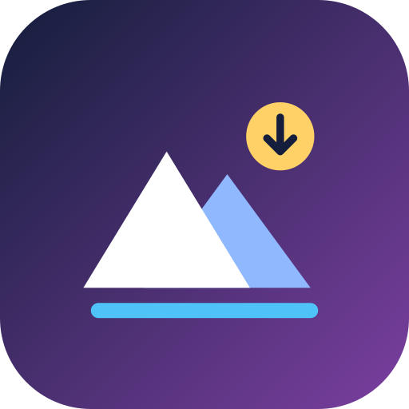

# Wallpapers 4K

App Android (Kotlin + Jetpack Compose) que busca wallpapers de boa qualidade e salva em `Pictures/Wallpapers4K`.

- **Orientação:** Comprido (vertical) ou Horizontal
- **Qualidade mínima:** Full HD (1920×1080), 2K (2560×1440) ou 4K (3840×2160). No modo comprido as medidas são invertidas. Padrão: 2K
- **Fontes:**
  - Wallhaven (sem chave, SFW)
  - Google Imagens via [Serper.dev](https://serper.dev) (chave gratuita, 2.500 consultas)
  - Pexels (opcional, [chave gratuita](https://www.pexels.com/api/))
- **Filtro de qualidade:** resultados do Google só aparecem se o link baixa de verdade (sem bloqueio de hotlink), é imagem (não HTML/SVG) e tem pelo menos ~150 KB.

## Build

O GitHub Actions compila a cada push na `main` e publica o APK **assinado** (release) em *Actions → Build APK → Artifacts*.

A assinatura usa `app/release.jks` (alias `wallpapers`), então todo APK novo instala por cima do anterior. A chave fica no repositório: serve para uso pessoal. Para publicar na Play Store, gere outra chave e guarde-a em secrets.

Chaves das fontes opcionais: crie os secrets `SERPER_KEY` e `PEXELS_KEY` em *Settings → Secrets and variables → Actions*. Sem chave, a fonte correspondente fica desativada.

Local: `gradle assembleDebug -PSERPER_KEY=sua_chave -PPEXELS_KEY=sua_chave`

> A API oficial Custom Search do Google está fechada para novos usuários e encerra em 01/01/2027, por isso o Google é acessado via Serper.
